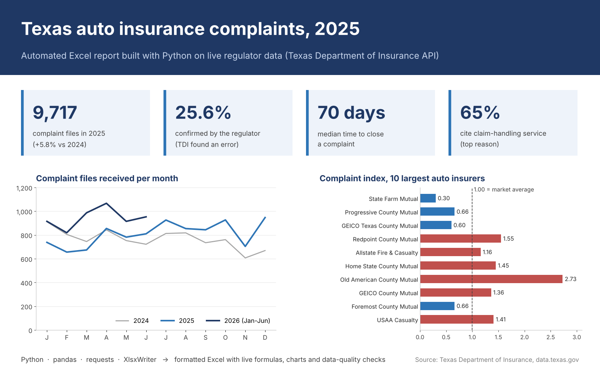
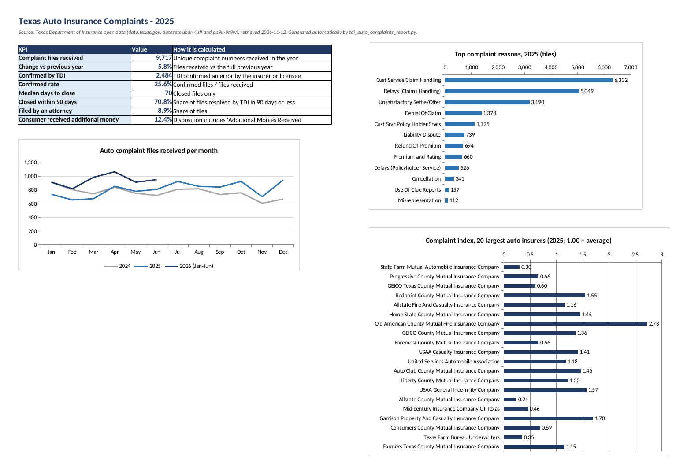

# Texas Auto Insurance Complaints: Automated Excel Report (Python)



A Python script that pulls **real public data** from the Texas Department of Insurance (TDI) open-data API, cleans it with pandas and writes a formatted Excel report in about 15 seconds. There are no copy-paste steps.

## Output
`TX_Auto_Insurance_Complaints_Report_2025.xlsx`
- **Summary:** 8 KPIs as live Excel formulas over the data sheet, plus 3 charts
- **Monthly:** complaint files per month, 2024 vs 2025 vs 2026 (complete months only)
- **Reasons / Respondents / Breakdowns:** what complaints were about, who was named, who filed them, time to close
- **Carriers:** the 20 largest auto insurers by policies in force, with the TDI complaint index (size-adjusted, conditional formatting)
- **Complaints_2025:** 9,717 complaint files, one row each, with filters
- **Data_Quality:** checks that run on every refresh

`TX_Auto_Insurance_Complaints_Report_2025.json` holds the same aggregates, ready to feed slides or a dashboard.

## Run it
```
pip install -r requirements.txt
python tdi_auto_complaints_report.py --year 2025
```



## Method
1. Download every automobile complaint received since 1 January of the previous year (paged SoQL queries, with retries).
2. Collapse the source, which has one row per complaint × respondent, into one row per complaint file. Reasons and dispositions are de-duplicated.
3. A file counts as confirmed if TDI found an error by at least one respondent. Days to close = closed date minus received date.
4. Complaint index (calculated by TDI) = a company's share of confirmed complaints ÷ its share of policies in force. 1.00 is the market average.
5. TDI publishes complaints once they are closed, so the most recent months are incomplete. The monthly trend stops at the last complete month.

## Key findings (2025)
- **9,717** auto complaint files, up 5.8% on 2024. Complaints received from January to June 2026 are already about 25% above the same months of 2025.
- **65%** cite customer service on claim handling, **52%** cite claim delays and **33%** cite an unsatisfactory settlement offer.
- TDI confirmed an error in **25.6%** of files. Delay complaints were confirmed 31% of the time, while denial complaints were confirmed 12% of the time.
- Median time to close was **70 days**, and 71% of files closed within 90 days. In 12.4% of files the consumer received additional money.
- Among the 20 largest auto insurers, the TDI complaint index ranges from **0.24 to 2.73**. The two largest carriers sit well below the market average.

## Sources
- Texas Department of Insurance, *Insurance complaints: All data*, data.texas.gov/d/ubdr-4uff
- Texas Department of Insurance, *Complaint indexes and policy counts for insurance companies*, data.texas.gov/d/pa9u-9s9w

Built by Stuard O. (Cesar Ore): Excel & Python data automation.
